--Exercise 1-a
--Departments: all columns and rows
 
 ```sql
 SELECT
    *
 FROM
    geo.departments;
```
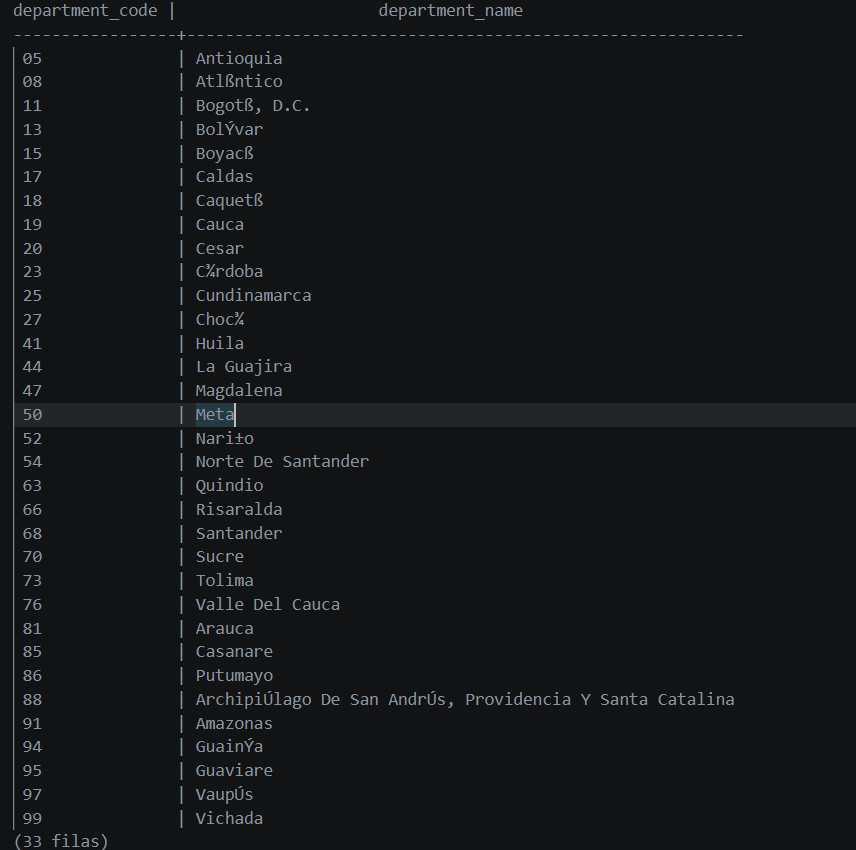

--Exercise 1-b
--Departments:code and name with column aliases

```sql
SELECT
    T1.department_code AS code,
    T1.department_name AS department
FROM
    geo.departments AS T1;
```
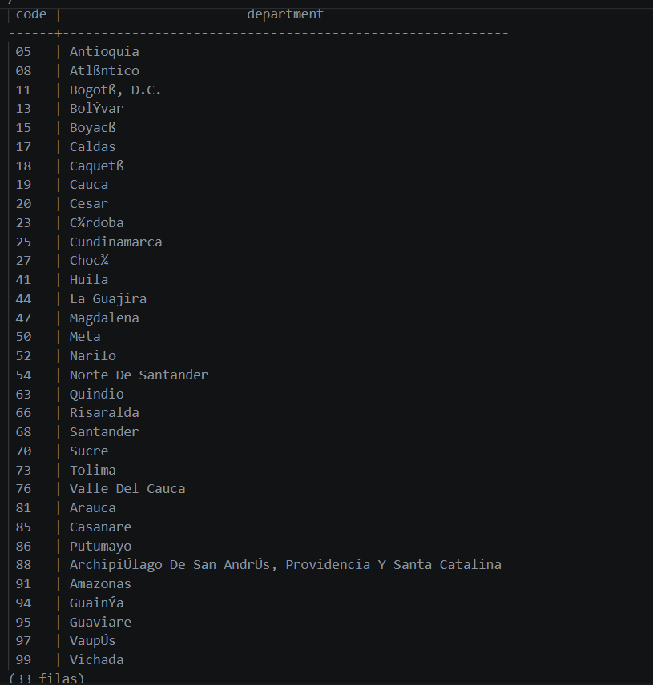


--Exercise 1-c
--Departments ordered alphabetically by name

```sql
 SELECT
    T1.department_code AS code,
    T1.department_name AS department
 FROM
    geo.departments AS T1
 ORDER BY
    T1.department_name ASC;
```
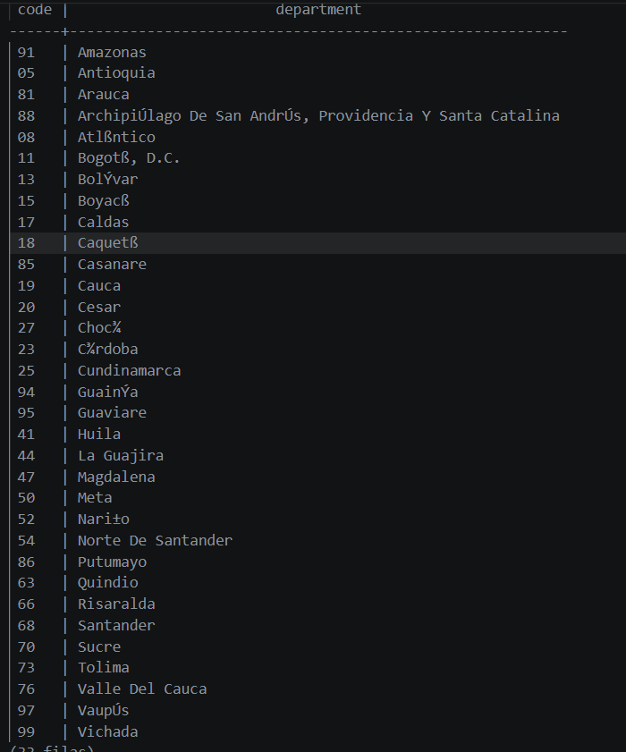

--Exercise 2-a
--Rust-resistant coffee varieties

```sql
SELECT
    T1.variety_name AS variety,
    T1.species AS species,
    T1.description AS description
FROM
    farm.coffee_varieties AS T1
WHERE
    T1.is_rust_resistant = TRUE;
```
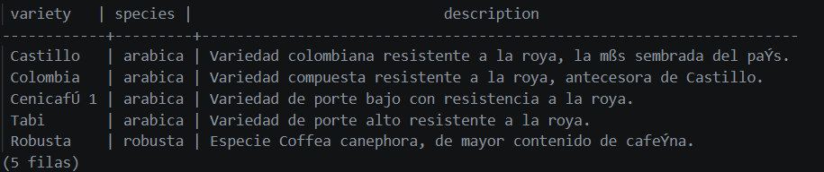

--Exercise 2-b
--Non-rust-resistant arabica varieties ordered descending

```sql
SELECT
    T1.variety_name AS variety,
    T1.species AS species,
    T1.description AS description
FROM
    farm.coffee_varieties AS T1
WHERE
    T1.is_rust_resistant = FALSE AND T1.species = 'arabica'
ORDER BY
    T1.variety_name DESC;
```

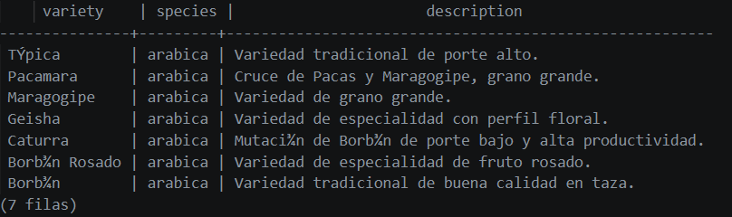

--Exercise 3-a
--Certifications ordered by premium per kg descending

```sql
SELECT
    T1.certification_name AS certification,
    T1.issuing_body AS issuer,
    T1.premium_per_kg AS premium_per_kg_cop
FROM
    farm.certifications AS T1
ORDER BY
    T1.premium_per_kg DESC;
```
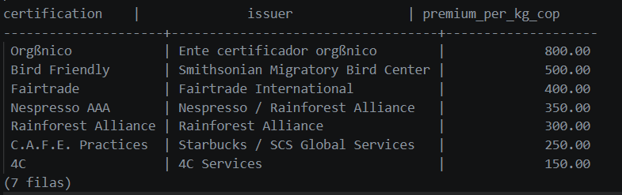

-Exercise 3-b
--Certifications with calculated premium per load (125 kg)

```sql
SELECT
    T1.certification_name AS certification,
    T1.issuing_body AS issuer,
    T1.premium_per_kg AS premium_per_kg_cop,
    (T1.premium_per_kg * 125) AS premium_per_load_cop
FROM
    farm.certifications AS T1
ORDER BY
    T1.premium_per_kg DESC;
```
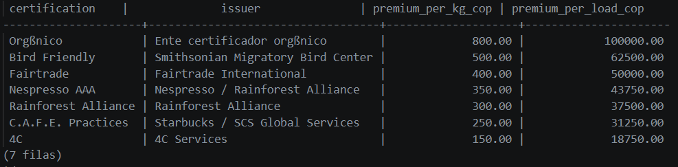

--Exercise 3-c
--Certifications with premium per kg greater than or equal to 350 COP

```sql
SELECT
    T1.certification_name AS certification,
    T1.issuing_body AS issuer,
    T1.premium_per_kg AS premium_per_kg_cop,
    (T1.premium_per_kg * 125) AS premium_per_load_cop
FROM
    farm.certifications AS T1
WHERE
    T1.premium_per_kg >= 350
ORDER BY
    T1.premium_per_kg DESC;
```
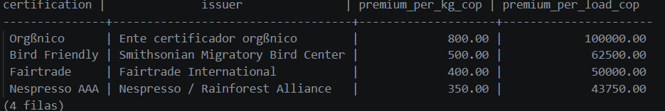

--Exercise 4-a
--Municipalities of Norte de Santander ordered alphabetically

```sql
SELECT
    T1.municipality_code AS municipality_code,
    T1.municipality_name AS municipality
 FROM
    geo.municipalities AS T1
WHERE
    T1.department_code = '54'
ORDER BY
    T1.municipality_name ASC;
```
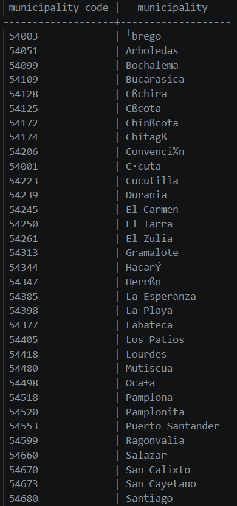

--Exercise 4-b
--Municipalities of Norte de Santander starting with 'San'

```sql
SELECT
    T1.municipality_code AS municipality_code,
    T1.municipality_name AS municipality
FROM
    geo.municipalities AS T1
WHERE
    T1.department_code = '54' AND T1.municipality_name LIKE 'San%'
ORDER BY
    T1.municipality_name ASC;
```
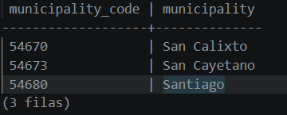

--Exercise 4-c
-- Municipalities nationwide containing 'Pamplona' case-insensitive

```sql
SELECT
    T1.municipality_code AS municipality_code,
    T1.municipality_name AS municipality
FROM
    geo.municipalities AS T1
WHERE
    T1.municipality_name ILIKE '%Pamplona%';
```
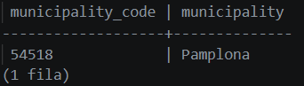

--Exercise 5-a
--Inactive collection points

```sql
SELECT
    T1.point_name AS point,
    T1.address_line AS address,
    T1.municipality_code AS municipality_code
FROM
    buy.collection_points AS T1
WHERE
    T1.is_active = FALSE;
```
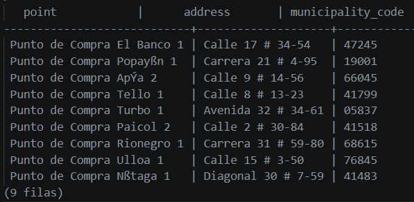

--Exercise 5-b
--Collection points without a registered phone number

```sql
SELECT
    T1.point_name AS point,
    T1.address_line AS address,
    T1.phone_number AS phone,
    T1.municipality_code AS municipality_code
FROM
    buy.collection_points AS T1
WHERE
    T1.phone_number IS NULL
ORDER BY
    T1.point_name ASC;
```
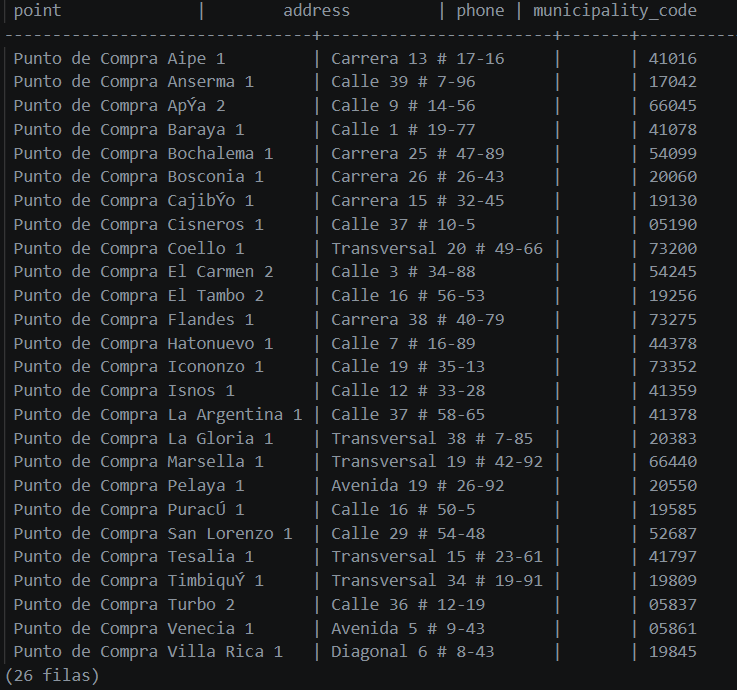

--Exercise 5-c
--Inactive collection points or without phone number

```sql
SELECT
    T1.point_name AS point,
    T1.address_line AS address,
    T1.phone_number AS phone,
    T1.is_active AS is_active,
    T1.municipality_code AS municipality_code
FROM
    buy.collection_points AS T1
WHERE
    T1.is_active = FALSE OR T1.phone_number IS NULL;
```
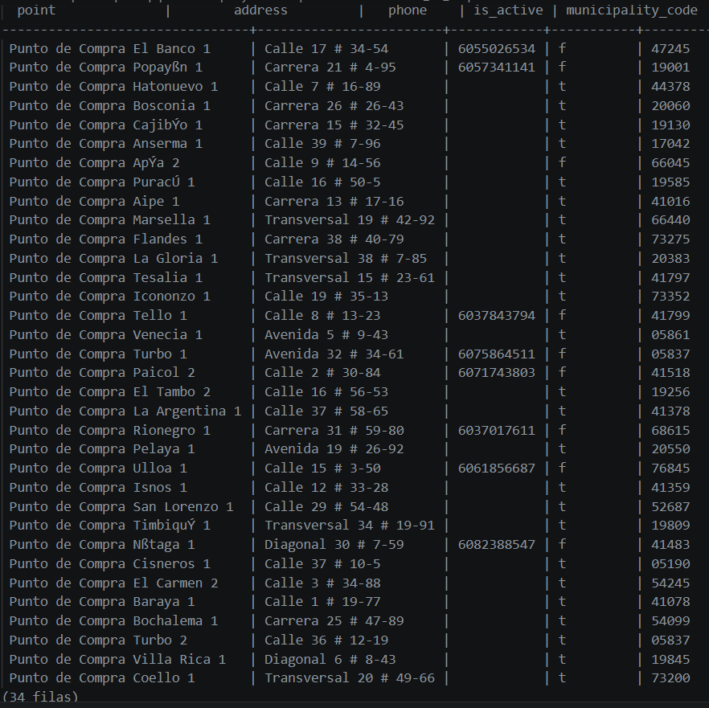

-Exercise 6-a
--Female farmers in municipality 54518 ordered by last name and first name 

```sql
SELECT
    T1.document_number AS document,
    T1.first_name AS first_name,
    T1.last_name AS last_name,
    T1.phone_number AS phone
FROM
    farm.farmers AS T1
WHERE
    T1.gender = 'F' AND T1.municipality_code = '54518'
ORDER BY
    T1.last_name ASC,
    T1.first_name ASC;
```
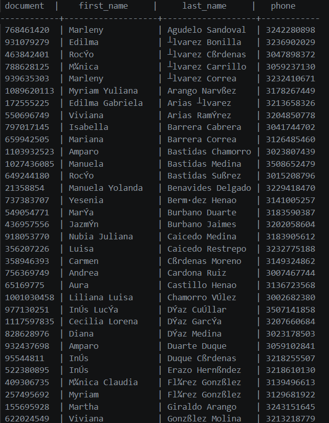

--Exercise 6-b
--Farmers in municipality 54518 without registered email

```sql
SELECT
    T1.document_number AS document,
    T1.first_name AS first_name,
    T1.last_name AS last_name,
    T1.email AS email
FROM
    farm.farmers AS T1
WHERE
    T1.municipality_code = '54518' AND T1.email IS NULL;
```
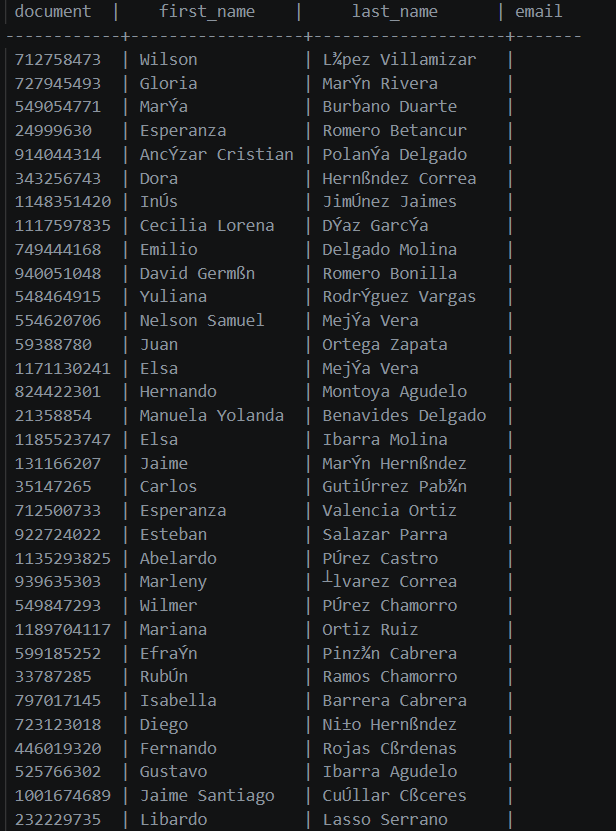

-Exercise 6-c
--Inactive farmers in municipality 54518 ordered by affiliation date 

```sql
SELECT
    T1.document_number AS document,
    T1.first_name AS first_name,
    T1.last_name AS last_name,
    T1.membership_date AS membership
FROM
    farm.farmers AS T1
WHERE
    T1.municipality_code = '54518' AND T1.is_active = FALSE
ORDER BY
    T1.membership_date ASC;
```
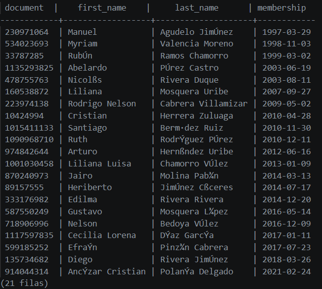

-Exercise 7-a
-- Farms in municipality 54518 above 1800 masl ordered by altitude descending

```sql
SELECT
    T1.farm_name AS farm,
    T1.rural_district AS rural_district,
    T1.total_area_ha AS area_ha,
    T1.altitude_masl AS altitude_masl
FROM
    farm.farms AS T1
WHERE
    T1.municipality_code = '54518' AND T1.altitude_masl > 1800
ORDER BY
    T1.altitude_masl DESC;
```
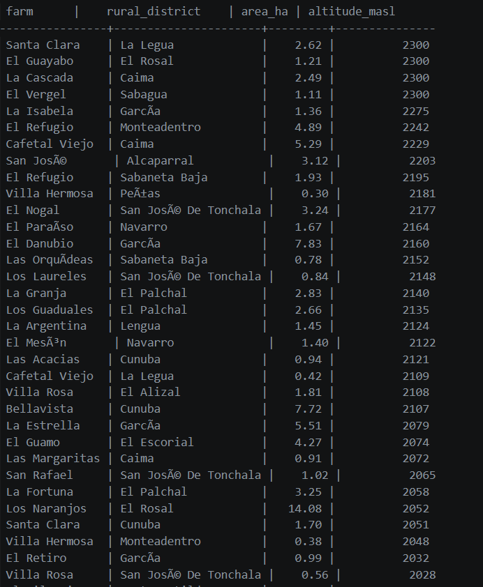


--Exercise 7-b
-- Farms in municipality 54518 between 1600 and 1800 masl

```sql
SELECT 
    T1.farm_name AS farm, 
    T1.rural_district AS rural_district, 
    T1.total_area_ha AS area_ha, 
    T1.altitude_masl AS altitude_masl
FROM 
    farm.farms AS T1
WHERE 
    T1.municipality_code = '54518' AND T1.altitude_masl BETWEEN 1600 AND 1800
ORDER BY 
    T1.rural_district ASC, T1.total_area_ha DESC;
```
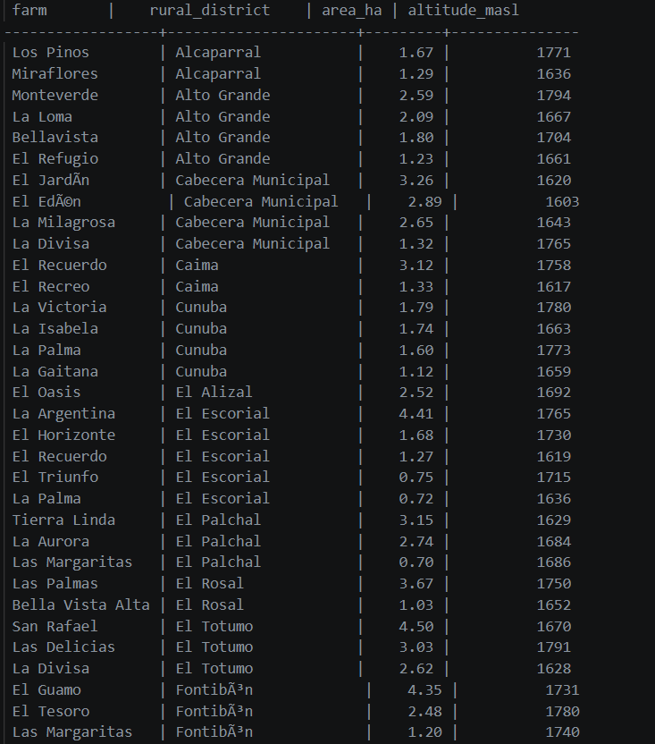

--Exercise 7-c
--Farms in municipality 54518 without geographic coordinates

```sql
SELECT

    T1.farm_name AS farm, 
    T1.rural_district AS rural_district, 
    T1.latitude AS latitude,
    T1.longitude AS longitude
FROM

    farm.farms AS T1
WHERE 
    T1.municipality_code = '54518' AND (T1.latitude IS NULL OR T1.longitude IS NULL);
```
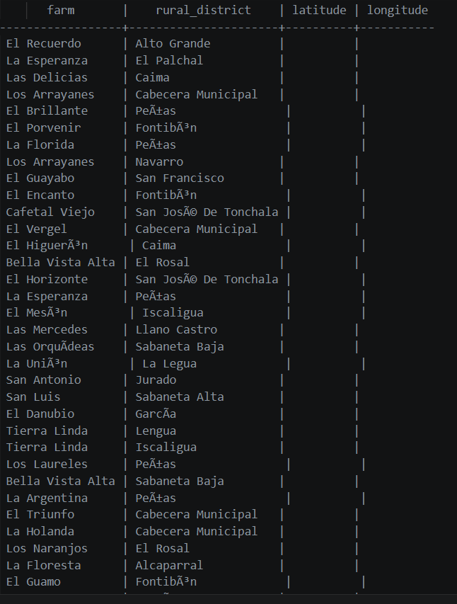


-Exercise 8-a
--Deliveries on September 30, 2026 ordered by receipt time

```sql
SELECT
    T1.delivery_id AS delivery,
    T1.farm_id AS farm_id,
    T1.collection_point_id AS collection_point_id,
    T1.delivered_at AS received_at,
    T1.coffee_type AS coffee_type,
    T1.gross_weight_kg AS gross_weight_kg
FROM
    buy.deliveries AS T1
WHERE
    T1.delivery_id LIKE '%20260930%'
ORDER BY
    T1.delivered_at ASC;
```
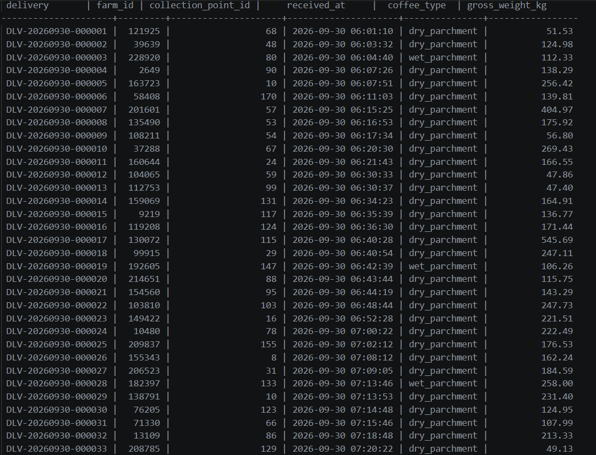

--Exercise 8-b
--Ejected deliveries on September 30, 2026 with average kg per bag

```sql
SELECT 
    T1.delivery_id AS delivery, 
    T1.delivered_at AS received_at,
    T1.gross_weight_kg AS gross_weight_kg, 
    T1.bag_count AS bag_count,
    (T1.gross_weight_kg / T1.bag_count) AS avg_kg_per_bag
FROM 
    buy.deliveries AS T1
WHERE 
    T1.delivery_id LIKE '%20260930%' AND T1.status = 'rejected'
ORDER BY 
    T1.delivered_at ASC;
```
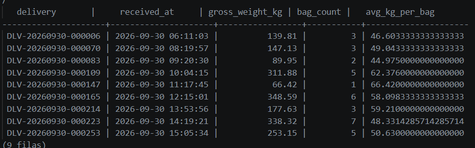


--Exercise 8-c
-- Deliveries on September 30, 2026 with wet parchment or cherry coffee types

```sql
SELECT 
    T1.delivery_id AS delivery, 
    T1.coffee_type AS coffee_type, 
    T1.gross_weight_kg AS gross_weight_kg
FROM 
    buy.deliveries AS T1
WHERE 
    T1.delivery_id LIKE '%20260930%' AND T1.coffee_type IN ('wet parchment', 'cherry')
ORDER BY 
    T1.gross_weight_kg DESC;
```
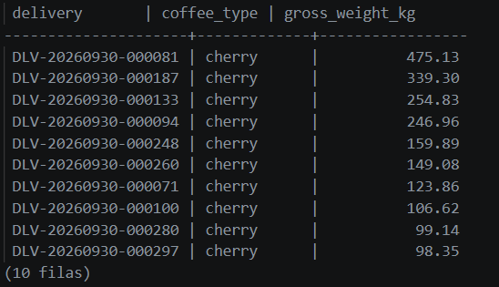


--Exercise 9-a
-- Quality analyses on September 30, 2026 with cup score >= 85

```sql
SELECT

    T1.analysis_id AS analysis, 
    T1.delivery_id delivery,
    T1.moisture_pct AS moisture_pct,
    T1.yield_factor AS yield_factor,
    T1.cup_score AS cup_score
FROM
    buy.quality_analyses AS T1
WHERE
    T1.cup_score >= 85 AND T1.analysis_id LIKE '%20260930%' and T1.moisture_pct BETWEEN 10 AND 12
ORDER BY
    T1.cup_score DESC;
```
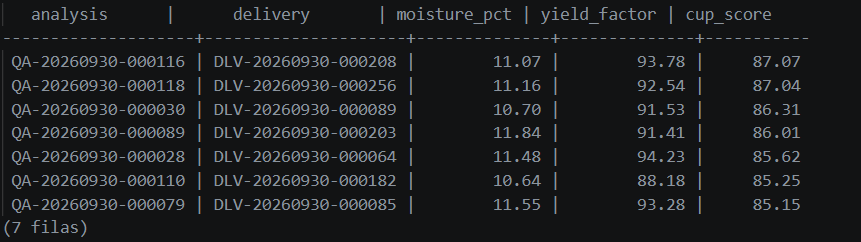


--Exercise 9-b
--Analysis where the moisture content is outside the 10%–15% range

```sql
SELECT
    T1.analysis_id AS analysis, 
    T1.delivery_id delivery,
    T1.moisture_pct AS moisture_pct,
    T1.cup_score AS cup_score,
    T1.analyst_name AS analyst_name,
    T1.observations AS observations
FROM
    buy.quality_analyses AS T1
WHERE
    T1.analysis_id LIKE '%20260930%' AND T1.moisture_pct NOT BETWEEN 10 AND 12
ORDER BY
    T1.cup_score DESC;
```
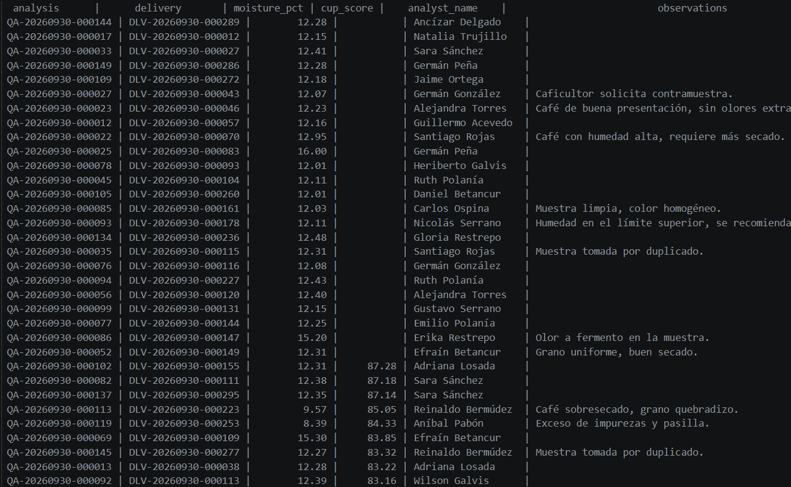

--Exercise 9-c
--Analyses that were not accepted but do have recorded observations

```sql
SELECT 
    T1.analysis_id AS analysis, 
    T1.delivery_id AS delivery, 
    T1.defects_pct AS defect_pct, 
    T1.observations AS observations
FROM 
    buy.quality_analyses AS T1
WHERE 
    T1.analysis_id LIKE '%20260930%' AND T1.is_accepted = FALSE AND T1.observations IS NOT NULL
ORDER BY 
    T1.defects_pct DESC;
```
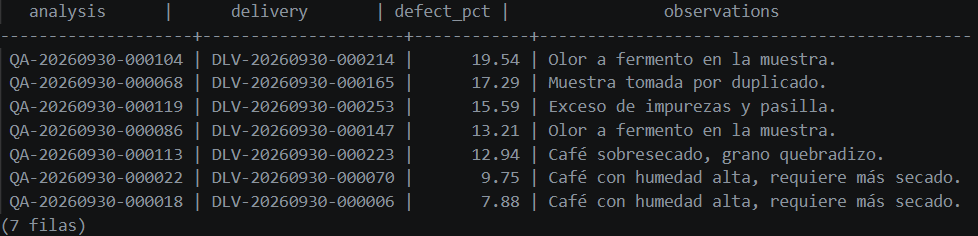

--Exercise 10-a
--Consult the settlement code, the delivery, the net weight, the price applied,
--the gross value, deductions and net value of settlements on that day

```sql
SELECT
    T1.settlement_id AS settlement,
    T1.delivery_id AS delivery,
    T1.net_weight_kg AS net_weight_kg,
    T1.price_per_kg_applied AS price_per_kg,
    T1.gross_amount AS gross_cop,
    T1.deductions_amount AS deductions,
    T1.net_amount AS net_cop
FROM
    pay.settlements AS T1
WHERE
    T1.settlement_id LIKE '%20260930%';
```
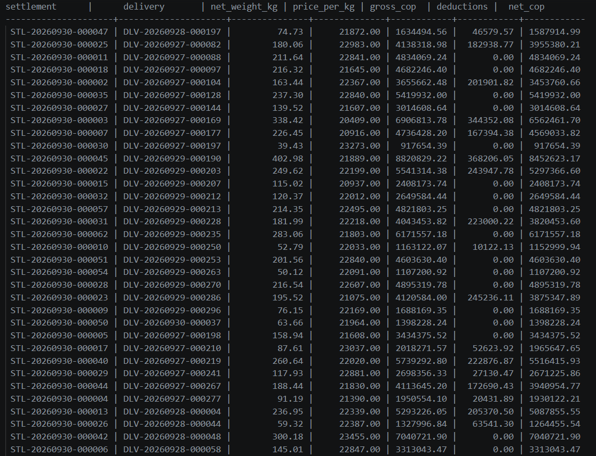

--Exercise 10-b
--View only the settlements with a status of "pending," ordered by net value from highest to lowest

```sql
SELECT
    T1.settlement_id AS settlement,
    T1.delivery_id AS delivery,
    T1.net_amount AS net_cop,
    T1.status AS status
FROM
    pay.settlements AS T1
WHERE
    T1.settlement_id LIKE '%20260930%' AND T1.status = 'pending'
ORDER BY
    T1.net_amount DESC;
```
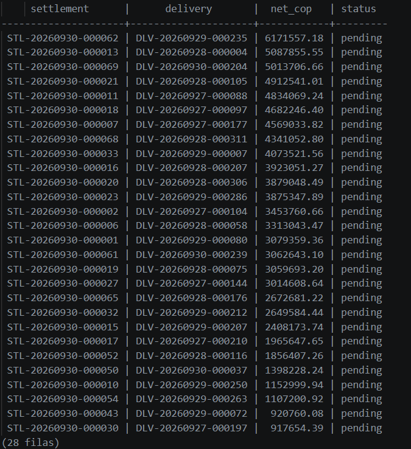

--Exercise 10-c
--Review the settlements without deductions, adding a
--calculated column that verifies the gross value

```sql
SELECT 
    T1.settlement_id AS settlement, 
    T1.net_weight_kg AS net_weight_kg, 
    T1.price_per_kg_applied AS price_per_kg, 
    (T1.net_weight_kg * T1.price_per_kg_applied) AS check_gross_cop, 
    T1.gross_amount AS gross_cop
FROM 
    pay.settlements AS T1
WHERE 
    T1.settlement_id LIKE '%20260930%' AND (T1.deductions_amount = 0 OR T1.deductions_amount IS NULL);
```
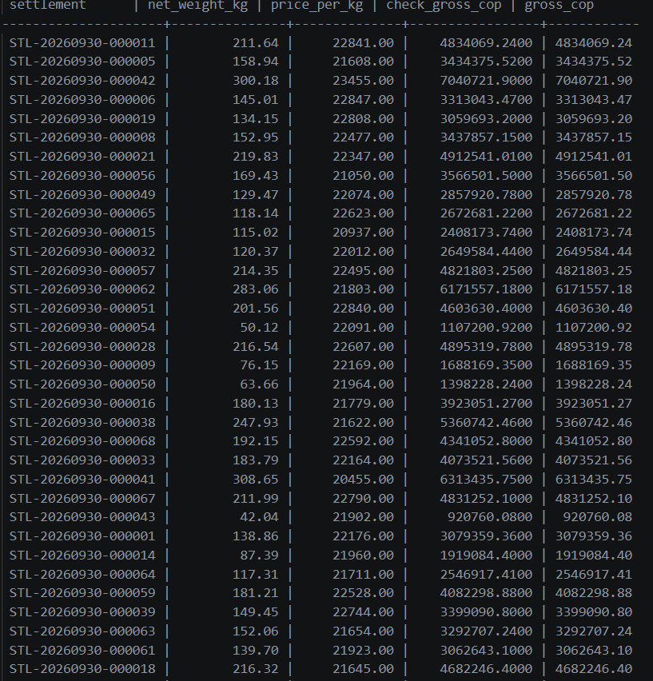


